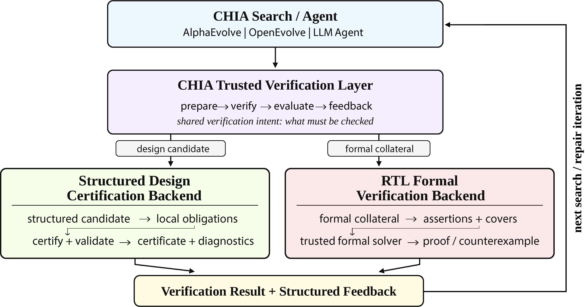

# CHIA Trusted Verification

- **Title:** Trusted Verification for Agentic Hardware Design in CHIA: Structured Design Certification and RTL Formal Verification
- **Author:** Sabrina Yarzada
- Contact: noorahma@usc.edu


<p align="center">
  
</p>

<p align="center">
  <em><strong>CHIA trusted verification flow.</strong> A shared interface checks agent-generated artifacts with a selected trusted backend and returns evidence to guide further search or repair.</em>
</p>


This repository accompanies the **“Trusted Verification for Agentic Hardware Design in CHIA: Structured Design Certification and RTL Formal Verification”** hackathon short paper at A³: Agentic Approaches to Architecture Workshop at MICRO 2026. It contains the reusable CHIA verification interface, the TeAAL-Evolve design certification backend, the Gemmini RTL formal verification backend, and scripts and data for reproducing the paper's results.

## Setup

Requires Python 3.10 or newer.

### Clone the repository

```bash
git clone https://github.com/SYarzada/chia-trusted-verification.git
cd chia-trusted-verification
```

### Install and check

```bash
python -m pip install -e ".[test]"
python -m pytest -q
python scripts/validate_teaal_certificates.py artifacts
```

These commands use the included code and 18 saved TeAAL certificates.

## Run experiments and reproduce results

- [TeAAL-Evolve quickstart](docs/TEAAL_EVOLVE_QUICKSTART.md) explains how to run accelerator design space exploration with TeAAL-Evolve.
- [RTL formal quickstart](docs/RTL_FORMAL_QUICKSTART.md) explains the Gemmini RTL formal verification setup and experiments.
- [Reproducing results](docs/REPRODUCE_RESULTS.md) explains how to inspect saved data and rerun analyses.

## Repository contents

| Path | Contents |
| --- | --- |
| `src/chia_trusted_verification/` | Shared verification interface, backends, and search integrations |
| `teaal_evolve/` | Accelerator inputs, kernels, and starting designs |
| `rtl_formal/` | Gemmini verification intents and formal example |
| `configs/`, `cluster/` | Experiment and worker settings |
| `experiments/`, `analysis/`, `scripts/` | Experiment and analysis scripts |
| `report_data/`, `artifacts/` | Processed results and 18 saved certificates |

## Paper results

The TeAAL-Evolve evaluation covers **560 runs and 16,779 proposals**. Optimized certification reduces mean checking time by about **200×** while matching the full checker's decisions. The Gemmini evaluation covers **72 runs and 288 proposals** across 24 verification intents. With iterative repair, compilation success improves from **43.1%** to **91.7%**, and decisive formal verification outcomes (proofs or counterexamples) increase from **34.7%** to **81.9%**.

This repository includes experiment results and 18 TeAAL verification certificates that can be independently checked. Full experiment logs are stored separately outside of this repository. See [paper results](report_data/README.md) for details.
